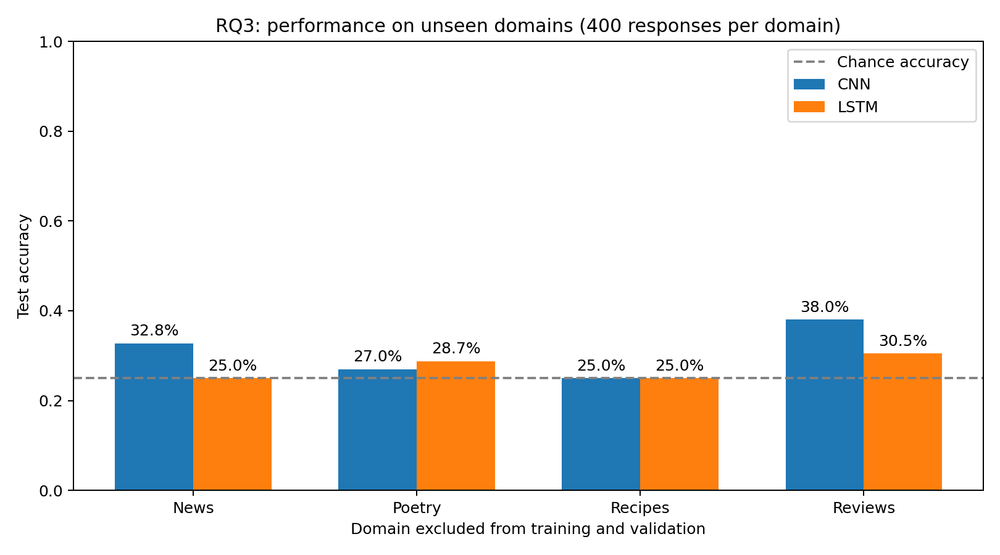

# RQ3: do LLM fingerprints generalize across domains?

This experiment trains new CNN and LSTM classifiers on three RAID domains and
tests on the fourth. It repeats for news, poetry, recipes, and reviews, giving
eight independently trained models. Inputs are generated responses only.

## Run

Use the same virtual environment and dependencies as RQ1, from the repository root:

```bash
.venv/bin/python -m unittest discover -s tests -v
.venv/bin/python rq3/run_rq3.py --device mps \
  --rq1-results rq1/results/seed42 --output-dir rq3/results/seed42
```

Use `--device cpu` on a machine without MPS, or omit `--device` for automatic
selection. Omit `--rq1-results` to run RQ3 without a baseline comparison. The
runner refuses to overwrite a nonempty output directory. Another seed requires
a new output directory; any supplied RQ1 reference must use the same seed and
hyperparameters. For dependency installation, see `rq1/README.md` and
`requirements-rq1.txt`.

## Fold construction

For each held-out domain:

| Partition | Selection | Sources | Responses |
| --- | --- | ---: | ---: |
| Training | Original training sources from the other three domains | 240 | 960 |
| Validation | Original validation sources from the other three domains | 30 | 120 |
| Test | All sources from the held-out domain | 100 | 400 |
| Unused | Original test sources from the other three domains | 30 | 120 |

All four responses from a source stay together. Source, prompt, and response
overlap checks run before training. No held-out-domain text is used for vocabulary
fitting, gradient updates, early stopping, or hyperparameter selection. Each
fold fits a fresh vocabulary on its own training text and initializes fresh
weights. The runner retains RQ1's architecture and hyperparameters, including
the 256-token cap, seed 42, 15-epoch maximum, and validation macro-F1 checkpoint
selection with patience 4. No RQ1 checkpoint is reused.

The shared trainer saves the same checkpoints, learning curves, test predictions,
confusion matrices, and per-class metrics as RQ1 under `results/seed42/DOMAIN/MODEL`.
The sole shared-code change for this step makes the confusion-matrix title
generic. Existing RQ1 results remain unchanged, and their source hashes describe
the historical RQ1 version of that plotting file.

## Two evaluations with different purposes

**All held-out responses:** each fold tests 400 responses. Pooling the four folds
gives 1,600 out-of-domain predictions per architecture, one for each dataset row.
These predictions come from four separately trained models, not one model.
Some of these rows were RQ1 training/validation examples, but none were used to
train or select the RQ3 model predicting them. Report mean domain macro F1 and
pooled macro F1 separately: they need not agree. Equal domain sizes make mean
domain accuracy equal pooled accuracy.

**Matched RQ1 comparison:** take only the 40 original test responses per domain
from the saved RQ3 predictions. These total exactly the same 160 response IDs
evaluated in RQ1. Compare them against the existing RQ1 predictions without
retraining or reevaluating the RQ1 models. The runner verifies dataset hashes,
hyperparameters, seed, IDs, source IDs, domains, and true labels before comparing.

The matched comparison controls test examples, but not training-set size:
RQ1 trains on 1,280 responses while RQ3 trains on 960. Thus the difference cannot
be attributed exclusively to domain shift. A size-matched mixed-domain baseline
would be an additional experiment. Do not directly subtract RQ1's 160-example
accuracy from the full 1,600-example RQ3 accuracy and call it a controlled drop.

## Aggregate outputs

- `protocol.json`: fold policy, hyperparameters, dataset/code hashes, and hashes
  of the RQ1 prediction files used for comparison.
- `fold_summary.csv`: accuracy, macro F1, and selected epoch per fold/model.
- `aggregate_metrics.json`: pooled metrics, means across domains, and the
  overall matched RQ1 comparison.
- `per_generator_by_domain.csv`: precision, recall, and F1 for each generator in
  each held-out domain, to assess which generators transfer most consistently.
- `cnn_out_of_domain_predictions.csv` and `lstm_out_of_domain_predictions.csv`:
  all 1,600 out-of-domain predictions for each architecture.
- `MODEL_matched_test_predictions.csv` and `matched_rq1_comparison.csv`:
  predictions and per-domain comparisons on the original test examples.
- `accuracy_by_domain.png`: accuracy on all 400 responses per held-out domain.

The models use the first 256 regex tokens; most responses are truncated.
This is one seed on a small, balanced subset of four older RAID generators.
Responses sharing a source and the overlapping training sets across folds mean
the predictions are not independent observations. The study tests transfer
among these four writing domains, not arbitrary tasks or current LLMs.

## Completed results: seed 42

All eight runs used MPS and the prespecified settings above. The following scores
use all 400 responses in each held-out domain:

| Held-out domain | CNN accuracy | CNN macro F1 | LSTM accuracy | LSTM macro F1 |
| --- | ---: | ---: | ---: | ---: |
| News | 32.75% | 0.2271 | 25.00% | 0.1086 |
| Poetry | 27.00% | 0.1534 | 28.75% | 0.2038 |
| Recipes | 25.00% | 0.1000 | 25.00% | 0.1000 |
| Reviews | 38.00% | 0.3268 | 30.50% | 0.2074 |
| Mean across domains | 30.69% | 0.2018 | 27.31% | 0.1550 |

Pooled across all 1,600 predictions, macro F1 is 0.2300 for CNN and 0.2036 for
LSTM. These pooled F1 values differ from the mean domain F1 values above.



For the comparison using exactly the original 160 RQ1 test responses:

| Model | RQ1 accuracy | RQ3 accuracy | Accuracy change | RQ1 macro F1 | RQ3 macro F1 |
| --- | ---: | ---: | ---: | ---: | ---: |
| CNN | 70.625% | 30.625% | -40.00 percentage points | 0.7012 | 0.2174 |
| LSTM | 57.500% | 23.750% | -33.75 percentage points | 0.5536 | 0.1671 |

### Interpretation

These classifiers show poor transfer to unseen domains. Both have substantially
lower accuracy on the matched test examples than in RQ1. This is consistent with
learning patterns that depend on the domain, rather than a reliably transferable
LLM fingerprint. It does not prove that domain shift alone caused the entire
drop, since training/validation sets are smaller in RQ3.

Recipes illustrate the failure particularly clearly: both classifiers predict
`cohere-chat` for all 400 responses, producing 25% accuracy and 0.10 macro F1.
The confusion matrices also show heavy Cohere prediction bias for unseen news
and poetry. Thus high Cohere recall is not evidence of uniquely reliable
identification. Across all domains, Cohere recall is 82.0% (CNN) and 76.25%
(LSTM), but its precision is only 27.7% and 25.8%, respectively. Llama and Mistral
are rarely recovered correctly. No generator is identified robustly across
all four held-out domains in these runs.

Reviews produce the highest all-response accuracy for both classifiers, but
scores remain low (38.0% and 30.5%). The LSTM's matched 40-response reviews
subset is only 22.5%, emphasizing that the small matched subsets can differ
from the full domain. Use the matched results for the RQ1 comparison and the
400-response results for describing each held-out domain.

All 18 regression tests passed before training. After training, saved prediction
metrics, data/code hashes, vocabulary fitting, and actual source/domain
separation were independently checked. No hyperparameters were changed in
response to held-out test performance.
